

  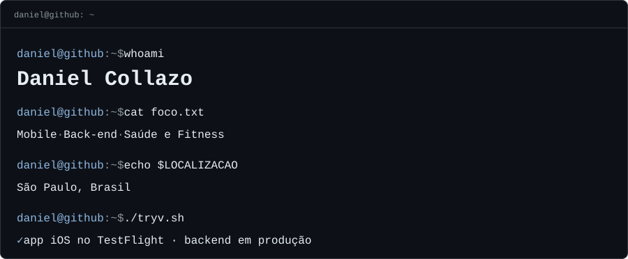

  <a href="https://www.linkedin.com/in/daniel-collazo-b80966401">LinkedIn</a>
  &nbsp;·&nbsp;
  <a href="https://tryvfit.app">Tryv Fit</a>
  &nbsp;·&nbsp;
  <a href="https://github.com/danielcollazo1305/tryv-backend">Código do backend</a>

 

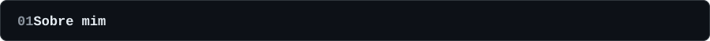

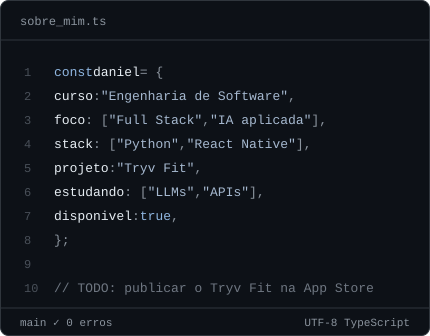

Sou estudante de Engenharia de Software (Anhanguera) e construo o **Tryv Fit**, um app iOS de treino e saúde, do aplicativo ao servidor: interface em React Native, backend em FastAPI e PostgreSQL, e integração com o Apple Saúde.

Gosto de transformar dados do dia a dia (sono, frequência cardíaca, treino) em algo que a pessoa entende e usa, inclusive com IA: o app gera treinos com apoio de um modelo de linguagem.

Trabalho com apoio de assistentes de IA (Claude Code): eu defino o que entra, reviso e testo no aparelho.

**Atualmente**

- Preparando o Tryv Fit para a App Store (versões de teste no TestFlight).
- Construindo as APIs de treino e de sono e estudando LLMs.
- Aberto a estágio e vagas júnior em full stack, back-end com Python e IA aplicada.

 

 

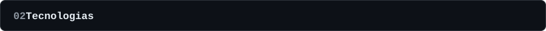

 

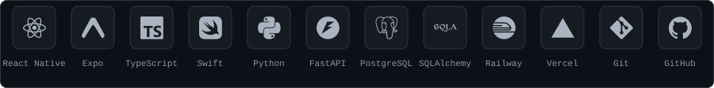

 

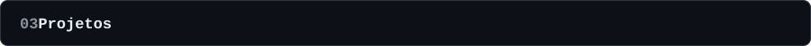

 

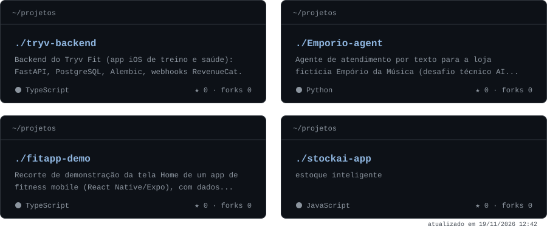

 

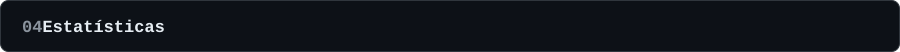

 

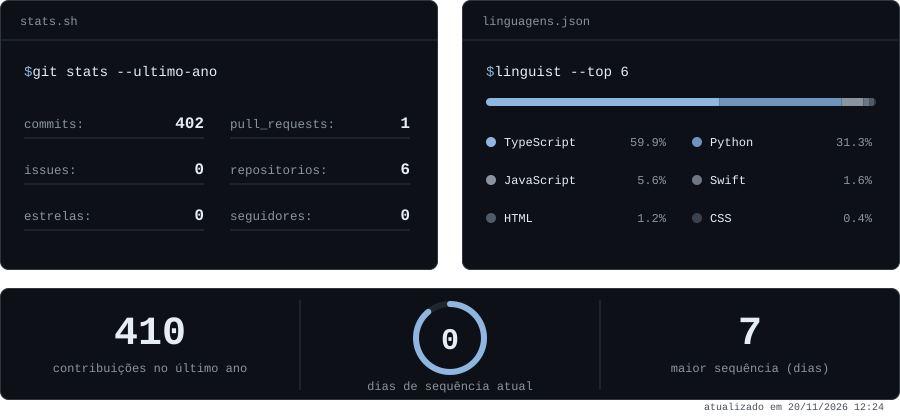

 

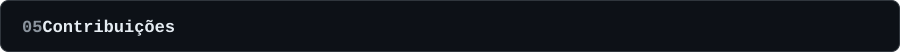

 

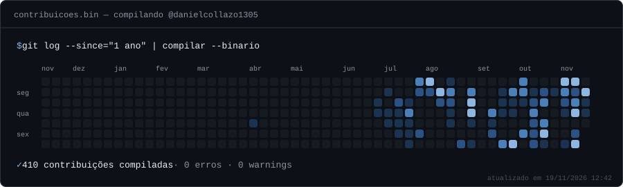

 

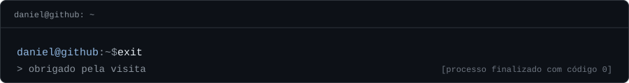
